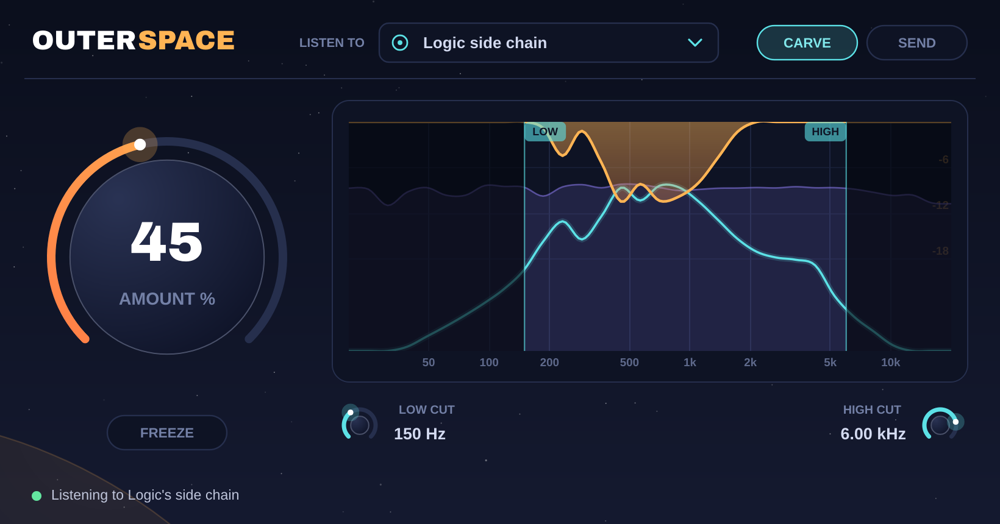
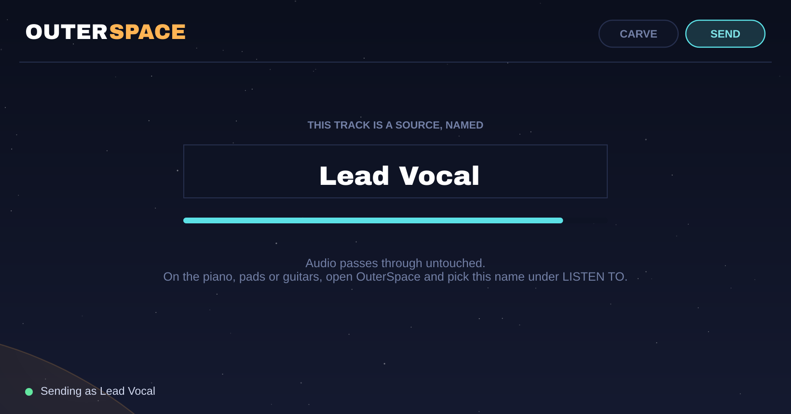

# OuterSpace

A Logic Pro (AU) mixing plugin that makes room for one track inside another.
Put it on the piano, pads or guitars, point it at the lead vocal, and it
carves the vocal's frequencies out of that track only where the two actually
overlap, while the vocal sings. One big knob, a range, a freeze button.
Built in the cloud.



## How it works

- Both tracks are measured in **32 bands**, a third of an octave apart from 20 Hz
  to 20 kHz, in real time. The carve follows the vocal as it moves up and down,
  with no automation.
- **Smart overlap.** A band is cut only where the vocal is present *and* this
  track is loud enough there to cover it. Parts of the track that sit
  away from the vocal, or already well below it, aren't touched.
- The cut is applied by 32 zero-latency bell filters with their interaction
  compensated, so the curve on the display is the curve you hear (within
  1 dB). No side chain or Amount at 0 means the audio passes through bit for bit.

## Controls

| Control | What it does |
|---|---|
| **Amount** | How deep the carve goes (up to 24 dB where the overlap is total). 10-20% is a good start. Double-click to reset. |
| **Low Cut / High Cut** | Carve only between these. Drag the LOW / HIGH markers on the display, turn the small knobs, or double-click the value to type one. |
| **Freeze** | Holds the current carve curve. |
| **Listen to** | The track to make room for (see below). |
| **Carve / Send** | This instance's role. |

On the display: **cyan** is the track you're listening to, **violet** is
this track, and **amber**, hanging from the top, is the cut.

## Choosing the track to listen to

Logic doesn't let a plugin see your track list or take audio from other
tracks itself, so there are two ways to do it:

1. **OuterSpace sends (recommended).** Put OuterSpace on the vocal and click
   **SEND**. It passes the vocal through untouched and appears by name
   (the track's name when Logic provides it; click it to rename). On the
   piano, open OuterSpace and pick that name under **LISTEN TO**. Any number of
   tracks can listen to the same send. Sends line up by song position, so the
   carve stays in time even when Logic processes the tracks in a different
   order or with different buffer sizes.
2. **Logic side chain.** Choose *Logic side chain* under LISTEN TO, then pick
   the vocal in the **Side Chain** menu in the plugin window's header.



The status line at the bottom says what it's listening to, or what's missing.

Tip for worship mixes: put OuterSpace on a bus that has all the keys and pads,
and listen to the lead vocal bus. The lyrics come forward and the band stays
full.

## Getting the plugin

Every push builds on GitHub Actions (macOS, universal Apple silicon + Intel).
Open the latest run under **Actions**, download **OuterSpace-macOS**, and follow
`INSTALL.txt` inside it. The run also has **dsp-renders**: before/after WAVs
of a test vocal over a pad.

The build runs the DSP tests (curve accuracy, bit-exact pass-through, carving
only where the overlap is, low/high cut, freeze, release, sample rates, buffer
size independence, CPU, send/listen alignment) and validates the AU with `auval`.

## Building locally (optional)

```
cmake -B build -DCMAKE_BUILD_TYPE=Release
cmake --build build --config Release
```

JUCE 8.0.9 is fetched automatically. `-DOUTERSPACE_SNAPSHOT=ON` also builds a
tool that renders the UI to PNGs.

## Layout

```
Source/dsp/Spacer.*            analysis, smart-overlap curve, compensated bells
Source/link/SourceRegistry.*   sends and listeners between instances
Source/PluginProcessor.*       buses, roles, state
Source/PluginEditor.*          the window
Source/ui/                     look and feel, spectrum display
Tests/DspTest.cpp              headless checks, run in CI
```

The Archivo Black font is bundled under the SIL Open Font License (`assets/fonts`).
